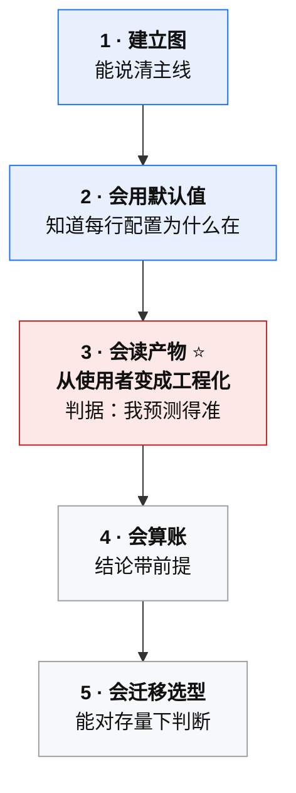

# 前端工程化：从底层原理到工程实践

> 一本由真实互动教学沉淀、再按知识地图扩写而成的技术电子书。
> **10 个领域 · 42 章 · 179 个节点**（最后更新 2026-10-17）。

## 这本书是什么

**起点**：2026 年 10 月 8 日至 10 日，一位有 HTML/CSS/JS 与 npm 基础的开发者，以「资深前端工程化专家」为对话对象，用三天的分节互动教学走完了四个模块、二十二节内容，主题是**前端打包构建**（核心原理 / Webpack 与 Vite / 新一代工具 / 学习路径）。

**现状**：三天课程只覆盖了打包构建这一块。本书在此之上，按 `KNOWLEDGE_MAP.md` 的**知识地图**向整个前端工程化扩写 —— 从「写出第一个页面」到「AI 在工程流程里的位置」，共 **10 个领域、40 章、179 个节点**。

| | 覆盖 |
|---|---|
| **D0 入门基础** | 47 节点 · HTML/CSS/JS、浏览器与渲染、HTTP 缓存、走进工程 |
| **D1 规范与协作** | 13 节点 · 写法统一、提交与评审、规模化治理 |
| **D2 语言与模块化** | 24 节点 · 模块体系、包管理与 monorepo、TypeScript |
| **D3 构建与打包** | 35 节点 · 依赖图、产物优化、HMR、缓存与 hash、构建性能、定制与迁移 |
| **D4 样式工程** | 13 节点 · 方案选型、样式工程化、设计系统与主题 |
| **D5 质量与测试** | 14 节点 · 静态质量门、测试层级、效率与门禁、体系与度量 |
| **D6 交付与运维** | 13 节点 · 制品与发布、流水线、CDN 与回滚、上线之后 |
| **X1 脚手架** | 3 节点 · 初始化器、模板仓库、代码生成器 |
| **X2 架构模式** | 10 节点 · 渲染形态、SSR 与同构、服务端形态、微前端 |
| **X3 AI 与工程化** | 7 节点 · AI 成为工具的用户、AI 在流程中的位置 |

**它是什么、不是什么**：不是聊天记录 —— 对话被按知识依赖重新组织，零散解释合并成完整讲解，重复内容去重。也**不是一篇篇互不相干的文章** —— 每章都带「前置」「待回链」「治理动作」「常见误区」，全书 179 个节点之间的引用**已全部闭合**（0 处悬空）。

**唯一刻意保留的"过程痕迹"**：那些有学习价值的反例、认知误区与纠错过程 —— 它们进了各章的「常见误区」（全书 930 条，**已剔除与正文重复的纯复述**）、`notes/correction-log.md` 与 `CHANGELOG.md` 的勘误记录。

## 怎么读

### 一条前置选择：按能力排，不按工具排

| 路线 | 顺序 | 代价 |
|---|---|---|
| **按工具排**（多数人的默认） | Webpack → Vite → Rspack → …… | **每次换工具都要重学一遍配置**，旧知识迅速报废 |
| **按能力排** | 建立图 → 会用默认值 → 会读产物 → 会算账 → 会迁移 | 学一遍，跨工具通用 |

**为什么"按工具排"是陷阱**：**工具名会变，机制不会变。** 依赖图、Loader/Plugin 分工、Tree Shaking 两阶段、代码分割三策略 —— 这些在 Rspack、Rolldown、Turbopack 里**全都还在**，只是换了执行者。

> **你花时间背的 `optimization.splitChunks` 默认值会过期；你理解的"为什么需要抽公共包"不会。**

### 五个台阶，以及它们的判据

| 台阶 | 目标 | 主要读 | **判据** | 常见跑偏 |
|---|---|---|---|---|
| **1 建立图** | 通用心智模型 | D3 第 1、4 章 · D2 第 1 章 | 说清「源码 → 依赖图 → chunk → 产物」 | 背配置项 |
| **2 会用默认值** | 跑通真实项目 | D3 第 2、3 章 | 每条配置项能说出「**为什么存在**」 | 一上手就装一堆插件 |
| **3 会读产物** ⭐ | **从使用者变成工程化** | D3 第 3、5、8 章 | **改一行代码能预测哪些产物 hash 会变；错了能解释为什么** | 只看体积，不看来源 |
| **4 会算账** | 结论站得住 | D3 第 7 章 · D6 第 4 章 | 听到「变快了」能拆出**绑定的指标与前提** | 拿厂商数字当结论 |
| **5 会迁移选型** | 对存量下判断 | D3 第 9 章 · X2 全领域 | 给得出「**能不能迁、要多久、翻车了怎么办**」 | 先比技术优劣，不问痛点 |

**⭐ 第 3 级是分水岭**：前几级的判据是「我说得清」（**陈述性**），第 3 级的判据是「我预测得准」（**预测性**）。而"改一行代码能预测哪些 hash 会变"这个判据的威力在于 —— **它一次性检验了「依赖图 + chunk 来源 + hash 计算范围 + 缓存三件套」四块知识**。你预测错了，就一定有一块没真正理解。

**不要为了"学完"而学**：1 → 2 → 3 必须串行（后面的判据依赖前面的能力）；**4、5 可以在真实项目需求出现时再补**。

### 五个动手项目（每个都必须能自证）

**配项目的两条标准**：① **小到一次做完**；② **必须能自证过关**（有判据，不靠感觉）。

**"能自证"是更重要的那条** —— 没有判据的项目，做完也不知道自己会不会。

| 台阶 | 项目 | 规模 | 过关判据 |
|---|---|---|---|
| 1 | **手写迷你打包器** | **≤100 行** | 跑通「两个文件互相 import」；能解释**共享模块为何只处理一次** |
| 2 | **零插件 Vite 项目** | 1 小时 | 每行配置能说出「为什么存在」；**删掉配置项目仍能跑** |
| **3** | **hash 预测游戏**（三页面项目） | 半天 | **改之前先写预测，连续 5 次正确** |
| 4 | **构建基准测量** | 半天 | 结论**每句都带前提** |
| 5 | **迁移评估一页纸** | 半天 | 结论**含「翻车了怎么办」** |

几个关键做法：

- **台阶 1**：目的不是做一个能用的打包器，是**验证依赖图不是背的**。最小实现 = 读入口 → 找 import → 递归解析 → 拼函数表 → 输出一个文件。
- **台阶 2 的反直觉动作**：**故意删掉所有配置，看还能不能跑** —— 你会发现大部分配置本来就不需要。
- **台阶 3（最推荐）**：分别做四种改动，**每次改前先写下预测**（哪些产物的文件名会变），改完对照 —— 改业务代码 / 改依赖版本 / 改 CSS / **只改注释（如果 hash 变了，说明缓存三件套没配齐）**。
- **台阶 5 的判据是第 ④ 段"回退路径"** —— **没有回退路径的是假报告**。

**一个自检问题**：五个项目里，哪个最容易被自己"糊过去"？**答案是台阶 2** —— 因为它最容易"跑起来就算完成"。**通用规则：先写判据，再动手。**

### 文档与源码：怎么读才不浪费时间

**文档的两种失败读法**：从第一页读到最后一页（读不完）；只搜 API（知道字段，不知道为什么）。

| 三种正确读法 | 用法 |
|---|---|
| **① 查 API** | **只搜，不读目录** |
| **② 读机制页** | 少数几页值得逐字读（各工具的 Concepts / Architecture 页） |
| **③ 读迁移指南** ⭐ | **性价比最高** —— 它写的是**官方承认的差异**，等于一份免费的对照表 |

> **读文档的判据：读到「已知限制 / deprecated」段落时，停下来精读。**
> 那是坑的官方来源，比任何第三方文章都权威。

**源码别从 `index.js` 读起**，三个切入点：**① 产物反推**（门槛最低 —— 读 `dist/` 的 runtime 胶水代码，直接看到动态 import 与 HMR 的实现证据）· **② 插件钩子** · **③ 具体 bug**（先搜报错字符串，顺调用栈往回读那一条路径）。

**铁律**：**只读你有一个具体问题的那条路径。** 漫读源码是最低效的学法。两条纪律：**先读类型定义（地图）再读实现（地形）**；**读完必须留下一个可验证的结论**（写不下「我验证了 X 是 Y」= 没读）。

### 三条按目的走的捷径

| 你的情况 | 建议路径 |
|---|---|
| 想建立完整心智模型 | 走上面的**五个台阶**（台阶 1–3 对应 D2/D3 主干） |
| 只想知道构建工具怎么选 | `D3` 第 9 章 §9.4（**约束 → 层次 → 工具**三层顺序）+ `decisions/tool-selection.md` |
| 手上有个老项目想提速/迁移 | `D3` 第 7 章（构建性能）+ 第 9 章 §9.5（迁移评估七字段） |
| 想搭一套质量体系 | `D5` 全领域（**先降 F，再谈覆盖率**） |
| 想上 SSR / 微前端 | `X2` 全领域（先读 §4.1「什么时候不该上微前端」） |
| 想复习关键结论 | `notes/knowledge-cards.md` + `appendix/glossary.md` |
| 想看踩过哪些坑 | 各章「常见误区」（**930 条**，已按"只留非复述"筛过）+ `notes/correction-log.md` |
| 想动手 | `practice/hands-on-index.md`（**451 条任务 + 120 条挑战**，按节点反查）+ `practice/exercises.md` |

## 全书导航

目录索引见 **`SUMMARY.md`**（按领域列出全部 42 章）。领域入口：

| 领域 | 章 | 入口 |
|---|---|---|
| D0 入门基础 | 8 | [第 1 章 · 写出第一个页面](chapters/d0-01-first-page.md) |
| D1 规范与协作 | 3 | [第 1 章 · 统一写法并让它自动生效](chapters/d1-01-unified-style.md) |
| D2 语言与模块化 | 3 | [第 1 章 · 模块体系](chapters/d2-01-module-system.md) |
| D3 构建与打包 | 9 | [第 1 章 · 从源码到产物](chapters/d3-01-source-to-artifact.md) |
| D4 样式工程 | 3 | [第 1 章 · 样式方案选型与组织](chapters/d4-01-styling-selection.md) |
| D5 质量与测试 | 4 | [第 1 章 · 静态质量门](chapters/d5-01-static-quality-gates.md) |
| D6 交付与运维 | 5 | [第 1 章 · 一次发布就是一套制品](chapters/d6-01-one-release.md) |
| X1 脚手架 | 1 | [第 1 章 · 脚手架与代码生成](chapters/x1-01-scaffolding-and-generators.md) |
| X2 架构模式 | 4 | [第 1 章 · 渲染形态与数据获取](chapters/x2-01-rendering-modes.md) |
| X3 AI 与工程化 | 2 | [第 1 章 · 视角与边界](chapters/x3-01-ai-perspective.md) |

## 给谁看

- 前端开发者中**已经会用**构建与工程工具、但说不清「为什么」的人
- 需要为团队做**选型、质量体系与架构形态决策**的人
- 想理解 Rust/Go 构建工具这一轮换代、SSR 与微前端的真实代价、AI 在流程中该站哪的人
- 需要一份**可复用的技术学习方法论**（而不只是知识点）的人

前提：会写 HTML/CSS/JS，装过 npm 包，跑过 `npm run dev` / `npm run build`。

## 阅读约定

正文中的结论分三类，均已标注：

| 标注 | 含义 |
|---|---|
| **【已学】** | 课程中讲解并互动确认过 |
| **【补充背景】** | 课程未覆盖，本书为补齐上下文而加入 |
| **【待验证】** | 课程中提出但未经实测或官方文档复核的推断 |

**另有一条本书反复执行的纪律**：**每条关键事实都标"核验日期 + 官方出处"，核不到的明确写"该页未覆盖"** —— 全书累计记录了数十处这样的缺口，而不是把它们抹平成断言。详见各章末尾的「来源与标注」与 `notes/compilation-log.md`。

## 维护说明

- 全书为纯 Markdown，无构建步骤，可直接在任何 Markdown 阅读器 / 静态站点生成器中渲染。
- 目录索引 `SUMMARY.md`；版本与覆盖范围 `METADATA.md`；修订记录 `CHANGELOG.md`；知识地图与节点依赖 `KNOWLEDGE_MAP.md`。
- **增量更新方式**：新增内容按章追加，并在 `CHANGELOG.md` 记一条；涉及工具版本、成熟度、性能数字时，**先核验官方文档再改**，改动处标注核验日期。
- 进度与断点状态见 `BUILD_PROGRESS.md`；原书内容的迁移状态见各文件的「落位标记」与 `MIGRATION_PLAN.md`。
- **改稿前后建议跑两条自查**：`python3 tools/link_check.py .`（死链 / 空节 / 占位）与 `python3 tools/dup_check.py .`（跨章近似重复）。后者只报**跨文件**的句子级重合，模板段已过滤；**它给线索，删留要人判断** —— 前向摘要、同源引用、刻意重复都应当保留。
